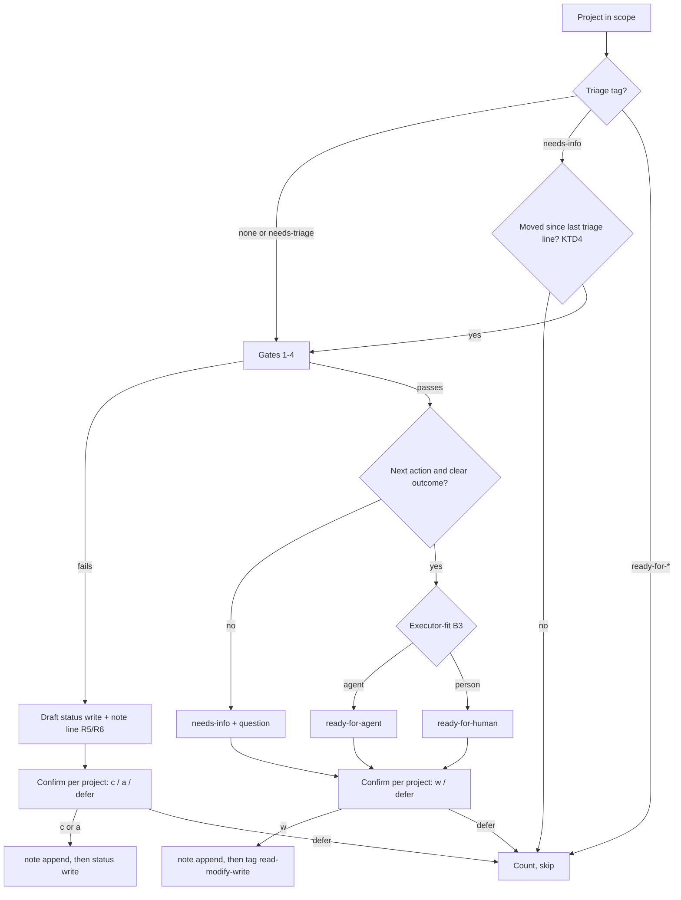

# Project Triage Command - Plan

---

## Goal Capsule

- **Objective:** A role-filler can run one cheap, repeatable pass over their GlassFrog projects that shows only the projects needing attention, retires the ones that fail a reality check, and leaves every other project with one saved route (and the reason for it) that the next pass resumes from.
- **Means:** a new `/holacracy:project-triage` command over a new shared gate reference, with state saved as a closed-list project tag plus a dated line in the project note (KTD1, KTD2, KTD3).
- **Authority:** ADR-0018 (split), ADR-0019 (vocabulary in the plugin), `skills/shared/triage-states.md` (closed list, write rules). This plan cites them and does not restate them.
- **Execution profile:** markdown-as-product plus small Python and shell changes to the eval harness. Test it like code (CLAUDE.md § Testing the skills).
- **Stop conditions:** stop and report if the stub cannot model `set_project_tags` replace semantics, or if a lint check cannot be given a mutation case.
- **Who finishes:** `ce-work` implements; a PR is opened and driven to green; Kraig merges.

---

## Product Contract

### Summary

Add `/holacracy:project-triage`, the project twin of `/holacracy:tension-triage`. It walks untriaged projects (and `needs-info` projects that moved), runs four reality gates first, routes each survivor to one state from `triage-states.md`, and writes the state tag plus a note line only on per-project confirmation. `/holacracy:review-project` keeps the deep single-project audit; its backlog modes become a deprecated dispatch to the new command.

### Problem Frame

The project backlog has no readiness practice, and most current projects in a real org were found idle. `review-project`'s backlog walk runs five lenses on every project every time and saves nothing, so nobody runs it often. ADR-0018 decided the split; #393 tracks the build.

### Requirements

**Scope of a pass**

- R1. The command shows a `current` project only when it has no triage-state tag, carries `needs-triage`, or carries `needs-info` and has moved since its last triage note (KTD4).
- R2. Projects tagged `ready-for-agent` or `ready-for-human` are counted in the summary but not walked.
- R3. Scope comes from `$ARGUMENTS`: none means the actor's own role projects; a circle name means that circle's projects. In circle scope, a project owned by a role the actor does not fill is walked and drafted but never written: the block shows the draft for the owner to apply and offers no write key (Holacracy: only the role-filler updates or closes the role's projects).

**Gates before routing**

- R4. Four reality gates run before any form check: outcome already reached, duplicate, superseded, owner role gone. An unfilled owner role is not a gate failure: the project routes to `needs-info` with the Circle Lead named as the one who decides.
- R5. A project that fails a gate is closed through its status, never a tag: `completed` when the outcome exists, `archived` otherwise, with the reason appended to the note (Key Decision 3).
- R6. A superseded project counts as superseded only when its successor already exists; the command names the successor in the note. With no successor found, the gate passes and routing sends the project to `needs-info` naming the missing successor. A duplicate pair names one survivor: only the other member is closed, the survivor is dropped from the pass, and a project whose named survivor was closed in this pass is never closed.

**Routing**

- R7. A project that passes the gates is routed to exactly one state from `skills/shared/triage-states.md` Step 1.
- R8. Agent versus human reuses the rubric's executor-fit test (`project-well-formedness.md` B3) on the next action.
- R9. Triage never runs the five critic lenses and never drafts reframes; it offers `/holacracy:review-project` on the one project instead.

**Writes**

- R10. A state change is one confirmed write pair: the tag set via read-modify-write (`triage-states.md` Step 3) and a dated line appended to the note (Key Decision 4).
- R11. No GlassFrog write happens without a per-project confirmation; the user can quit at any point.

**Compatibility and done**

- R12. `/holacracy:review-project` with no argument or a circle argument says the walk moved and runs `/holacracy:project-triage` with the same argument.
- R13. The forward reference for `/holacracy:project-triage` is removed and ADR-0018 reads Accepted.
- R14. A behavioural eval case covers the gates, the resume rule, and the tag replace semantics against the stub.

### Key Decisions

- Triage is separate from review-project. (session-settled: user-directed — chosen over extending review-project's backlog walk: one surface doing readiness and quality saves no state.) Governs R9, R12.
- The closed state list lives in `skills/shared/triage-states.md`. (session-settled: user-approved — chosen over a glassfrog-config vocabulary: that repo covers role tags only; ADR-0019.) Governs R7.
- Archive is a status: `completed` when the outcome exists, `archived` otherwise. (session-settled: user-directed — chosen over an `archived` tag: the status field already models it.) Governs R5.
- No tag-only writes; the reason goes in the note, read first and appended. (session-settled: user-directed — chosen over a bare tag write: a bare tag loses the routing decision's provenance.) Governs R5, R10.
- Every write is drafted, shown, and confirmed per project. (session-settled: user-directed — chosen over batch auto-write: these are writes to a live org.) Governs R11.

### Scope Boundaries

- Not built: a sweep that checks hand-set tags already on live projects for typos. ADR-0019 names it as future hygiene work.
- Not built: removing review-project's walk modes. They stay as a deprecated dispatch until a major release (ADR-0018 decision 2).
- Not built: triage of `waiting`, `someday`, or `scheduled` projects. `/holacracy:stalled-project-sweep` owns `waiting`; the other two are deliberately not-now.
- Not built: action triage. The A3 yokoten names it as a later read-only count first.

### Deferred to Follow-Up Work

- A3 Rev K update and #393 close comment after merge (outside the repo).

### Sources

- `docs/adr/0018-separate-project-readiness-from-project-quality.md`, `docs/adr/0019-the-triage-state-vocabulary-lives-in-the-plugin.md`
- `commands/tension-triage.md` (shape to mirror), `commands/stalled-project-sweep.md` (status writes), `commands/review-project.md` (walk to move)
- `skills/shared/project-well-formedness.md` B3 (executor-fit), `skills/shared/triage-states.md` Steps 1-3
- `evals/stub/glassfrog_stub.py`, `scripts/glassfrog-fixture-gen.py`, `scripts/run-behavioural-eval.py` (`run_check` kinds)

---

## Planning Contract

### Key Technical Decisions

- KTD1. The gates get a new shared reference, `skills/shared/project-triage-gates.md`, not new steps in `triage-gates.md`. `triage-gates.md` is tension-specific and its callers cite steps by number; appending project gates there would mix two item types under one numbering that six callers depend on.
- KTD2. The triage note is a timestamped line appended to the project's `note`: `Triage YYYY-MM-DDTHH:MMZ: <state or status> -- <reason or open question>` (UTC, to the minute). `glassfrog_update_project` accepts `note` (settled in A3 Rev D). This closes ADR-0018's deferred "where triage notes live" question.
- KTD3. The tag write and the note write are one confirmation and two calls, note first. If the tag write then fails, the note still records the decision and the failure is reported; the reverse order could leave a tag with no reason, which Key Decision 4 forbids.
- KTD4. Movement for a `needs-info` project means either the project's `updated_at` is more than 10 minutes after its last triage line's timestamp, or an action on the project was created or updated after that timestamp. The 10-minute window absorbs the bump from the triage write itself; a same-day answer still counts as movement. Action activity is checked separately because adding an action does not bump the project's `updated_at` (A3 baseline). Record this as a heuristic in the gate file.
- KTD5. Routing order after the gates: no next action, or an outcome the owner must clarify, routes to `needs-info` with the question in the note; otherwise executor-fit decides `ready-for-agent` or `ready-for-human`. `needs-triage` is written only when the user asks to reopen a project. Defer writes nothing.
- KTD6. The stub gains `glassfrog_get_project` (read) and `glassfrog_set_project_tags`, `glassfrog_update_project` (writes). Action movement and next-action presence come from the existing `glassfrog_list_role_actions`, grouped by `parent_project_id` (one call per role, not per project). `set_project_tags(project_id, tag_names)` replaces the whole set, using the live argument name `tag_names`; the stub rejects a call that sends `tags` instead, as it already 422s on `meeting_type`. `update_project` merges `note` and `status`. Fixture specs gain optional per-project `tags`, `note`, `created_at`, `updated_at`, and per-action `updated_at`.
- KTD8. Project tag writes on the live server are owner-only and flag-gated (`GLASSFROG_WEB_TAG_WRITES`; other callers are refused). The command checks at the start of a pass that `glassfrog_set_project_tags` is offered. If it is not, or the first tag write is refused, state routes are shown as drafts only and nothing is tagged; status closures (`update_project`) still work. The summary says so.
- KTD7. The shipped-case id guard in `run-behavioural-eval.test.sh` § 6 is widened to `proj_` ids so the new case's checks are covered.

### High-Level Technical Design

Per-project flow inside one pass:

### Assumptions

- The live `glassfrog_update_project` accepts `note` and `status` in one call. Evidence: A3 Rev D read of the server source.
- The live `glassfrog_list_role_projects` returns `tags`, `note`, and `updated_at` on each project (captured schema `evals/fixtures/schema/list_role_projects.json`).
- Live `glassfrog_set_project_tags` takes `{ project_id, tag_names }` and accepts only the web-session owner (glassfrog-mcp-server `src/tools/project_action_tags.ts`); KTD8 covers other callers.
- Kraig's "start the step 8 build" authorizes skipping the scoping confirmation; the inferred choices are KTD1, KTD4 and KTD5.

---

## Implementation Units

### U1. Stub and fixture support for project triage

- **Goal:** the eval stub can serve and record everything the command reads and writes.
- **Requirements:** R10, R14; KTD6.
- **Dependencies:** none.
- **Files:** `evals/stub/glassfrog_stub.py`, `scripts/glassfrog-fixture-gen.py`, `scripts/evals-harness.test.sh`.
- **Approach:**
  1. Fixture generator: accept optional `tags`, `note`, `created_at`, `updated_at` on project specs and `updated_at` on action specs; reject unknown keys as today.
  2. Stub read: `glassfrog_get_project(project_id)` returns the current (post-write) record.
  3. Stub writes: `glassfrog_set_project_tags(project_id, tag_names)` replaces the set and rejects a call without `tag_names` or with `tags`; `glassfrog_update_project(project_id, note?, status?)` merges; both are logged and update the in-memory project so a later read sees them.
  4. Advertise the new tools' inputs in `tool_list()`, including `tag_names` as a string array and `project_id`.
- **Patterns to follow:** existing `update_tension` in-memory update; § 4g-4j of `evals-harness.test.sh`.
- **Test scenarios:**
  - `set_project_tags` with `["ready-for-agent"]` on a project carrying `["budget"]` leaves exactly `["ready-for-agent"]` on a following `get_project`.
  - `update_project` with `note` only keeps `status`; with `status` only keeps `note`.
  - Both writes appear in the write log in order with args intact; `get_project` never does.
  - `set_project_tags` sending `tags` instead of `tag_names` is rejected.
  - A scenario with a typo'd project key (`tag` for `tags`) fails generation.
  - `tools/list` advertises the three new tools.
- **Verification:** `bash scripts/evals-harness.test.sh` passes with the new cases.

### U2. Shared gate reference

- **Goal:** one file owns the project gates, the routing order, the note format and the movement rule.
- **Requirements:** R1, R4-R8, R10; KTD1, KTD2, KTD4, KTD5.
- **Dependencies:** none.
- **Files:** `skills/shared/project-triage-gates.md` (new), `skills/shared/triage-states.md`, `skills/shared/project-well-formedness.md`.
- **Approach:**
  1. Steps: 1 outcome already reached, 2 duplicate, 3 superseded (successor must already exist, else `needs-info`), 4 owner role gone (unfilled routes to `needs-info` naming the Circle Lead), 5 route (KTD5, citing `project-well-formedness.md` B3 and `triage-states.md` Step 1), 6 the triage note line and movement rule.
  2. Each gate states its evidence, its outcome, and that it drafts and never writes.
  3. `triage-states.md`: change "not built yet" to the built command and point Step 3 at the note rule. Bump nothing; shared files carry no version.
  4. `project-well-formedness.md` "Loaded by": add project-triage (B3 only).
  5. Synthetic examples only. Every `needs-*`/`ready-for-*` name used must be in a closed list (lint check 11).
- **Patterns to follow:** `skills/shared/triage-gates.md` step layout and "Outputs of the gates".
- **Test scenarios:** Test expectation: lint only -- markdown reference; `skills-lint.sh` checks 1, 2, 6, 9 and 11 cover its paths, step citations, callers, tool names and state names.
- **Verification:** `skills-lint.sh` clean.

### U3. The command

- **Goal:** `/holacracy:project-triage` exists and follows the flow above.
- **Requirements:** R1-R3, R9-R11; KTD3, KTD8.
- **Dependencies:** U2.
- **Files:** `commands/project-triage.md` (new).
- **Approach:**
  1. Frontmatter: `description` (readiness only; names the deep audit as review-project's job) and `argument-hint`.
  2. Steps: resolve actor (cite `actor-and-role-resolution.md` Steps 1-2), resolve scope, list current projects, filter per R1-R2, run gates and route per `project-triage-gates.md`, present a per-project block with keys, write per KTD3, summarize.
  3. Keys: `[w]` write the drafted route, `[r]` hand to review-project, `[d]` defer, `[q]` quit; a gate failure offers `[c]` complete or `[a]` archive instead of `[w]`; a project of a role the actor does not fill (circle scope) offers no write key; a duplicate block names the survivor.
  4. "Where this command stops" and "Why this command exists" sections, mirroring tension-triage.
- **Patterns to follow:** `commands/tension-triage.md` layout; `commands/stalled-project-sweep.md` status write and honesty about heuristics.
- **Test scenarios:** covered by U5's behavioural case; Test expectation for this file alone: lint only -- checks 3, 5, 7, 8 and 9.
- **Verification:** lint clean; the forward-reference entry can be dropped without check 5 failing.

### U4. Deprecated dispatch and docs

- **Goal:** the old entry points and docs say where the walk went.
- **Requirements:** R12, R13.
- **Dependencies:** U3.
- **Files:** `commands/review-project.md`, `skills/shared/project-review-critics.md`, `evals/forward-references.txt`, `docs/adr/0018-separate-project-readiness-from-project-quality.md`, `README.md`, `CLAUDE.md`.
- **Approach:**
  1. review-project: replace the no-arg and circle-arg rows with a deprecation line and dispatch; drop the backlog-walk-only text (inline passes, one-line verdicts); keep the deep review intact; update the description.
  2. project-review-critics: the inline mode line says the backlog walk moved to project-triage, which runs no lenses.
  3. Drop the forward-reference line.
  4. ADR-0018: status Accepted (merged 2026-10-22 via #394); its Deferred bullet on triage notes points at KTD2's file.
  5. README command list and CLAUDE.md shared-reference paragraph gain the command and the gate file.
- **Test scenarios:** Test expectation: lint only -- docs and command prose; check 5 fails if a dangling reference to the command remains or the command is missing.
- **Verification:** lint clean; `grep` finds no other text describing the review-project backlog walk as current behaviour.

### U5. Behavioural eval case

- **Goal:** a graded case proves the gates fire first, the resume rule skips settled projects, and tag writes keep other tags.
- **Requirements:** R1, R2, R4, R5, R7, R10, R11, R14; KTD7.
- **Dependencies:** U1, U3.
- **Files:** `evals/scenarios/project-triage.json` (new), `evals/fixtures/glassfrog/project-triage.json` (generated), `evals/cases/project-triage/evals.json` (new), `scripts/run-behavioural-eval.test.sh`.
- **Approach:**
  1. Synthetic org (new names, `example.invalid` emails): one role the actor fills with six current projects: a duplicate pair, one whose note says the outcome shipped, one already `ready-for-human`, one `needs-info` answered later the same day, and one untriaged well-formed project carrying a non-state tag.
  2. Eval 0, read-only prompt: no writes (floor, non-discriminating); judged assertions that the duplicate and the shipped project are caught before any form critique, the shipped one is proposed as `completed`, the `ready-for-human` project is not walked, and no rubric verdict is proposed as a tag.
  3. Eval 1, prompt grants go-ahead: `write_present` of `set_project_tags` on the untriaged project; `no_write_of` any `set_project_tags` whose `tag_names` lack the pre-existing tag; `no_write_of` a status write on the duplicate pair's named survivor (negative-lookahead `args_match`); `no_write_of` a tag matching rubric verdicts or `archived`; `write_present` of `update_project` with `status: completed` on the shipped project.
  4. Add a `needs-info` project whose `updated_at` is later on the same day as its triage line; it is walked (KTD4).
  5. Widen § 6's id regex to `proj_`.
- **Patterns to follow:** `evals/cases/tension-triage/evals.json`; every assertion declares `discriminating`, and a non-discriminating one carries `why_kept`.
- **Test scenarios:**
  - The generated fixture is byte-identical on regeneration.
  - `run-behavioural-eval.py --validate-only --no-session-probe` accepts the case file.
  - § 6 finds every `proj_` id the checks name in the fixture's `key_map`.
- **Verification:** `run-behavioural-eval.test.sh` and `evals-harness.test.sh` pass; the leak scan stays clean.

---

## Verification Contract

| Command | Proves |
|---|---|
| `bash scripts/skills-lint.sh` | paths, step citations, frontmatter, command refs, orphans, roster delegation, limits, tool names, grants, state names |
| `bash scripts/skills-lint.test.sh` | the lint's own mutation suite still passes |
| `bash scripts/evals-harness.test.sh` | stub and generator changes (U1), leak scan |
| `bash scripts/run-behavioural-eval.test.sh` | the new case validates against its fixture (U5) |
| `shellcheck --severity=style -x -P scripts scripts/*.sh scripts/lib/*.sh` (0.11.0) | shell edits |

The graded nightly run is not part of this PR; it runs after merge.

---

## Definition of Done

- All five units landed; every command in the Verification Contract passes locally.
- No hand edit to `version.txt`, `.release-please-manifest.json`, or `plugin.json` `$.version`; the commit is `feat:`.
- No live-org data anywhere in the diff (names, ids, counts from the A3).
- No abandoned-attempt code or stray scratch files in the diff.
