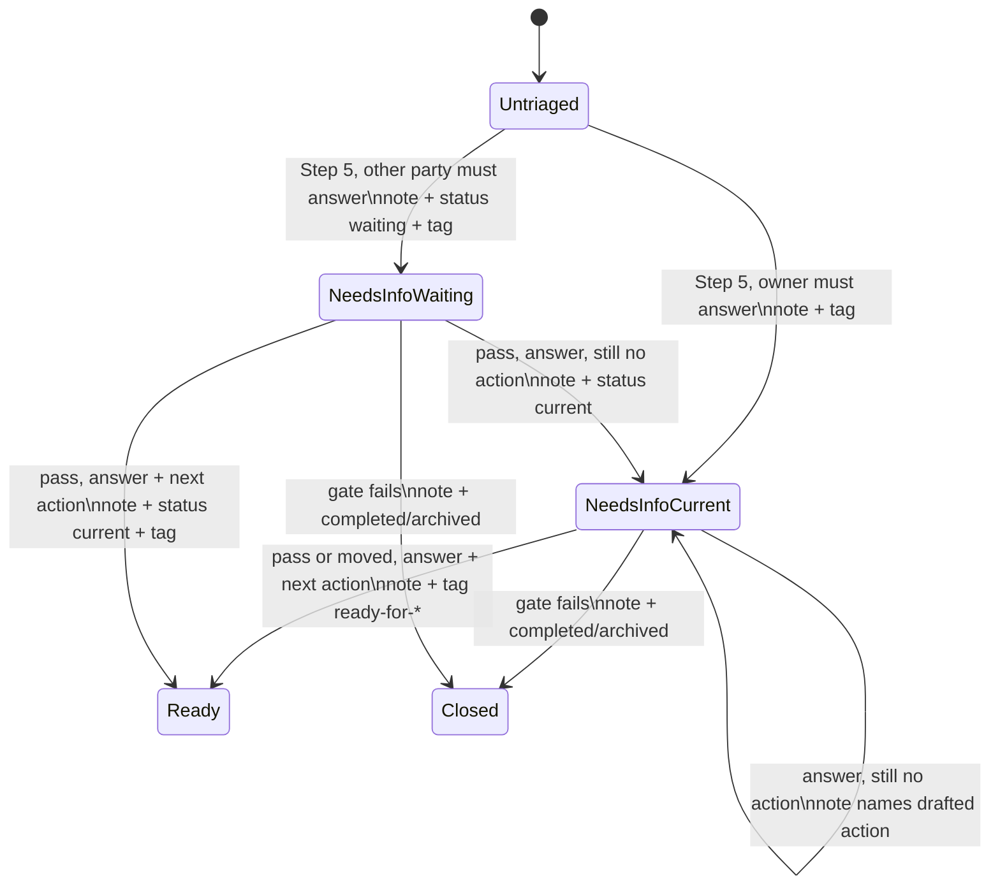

# Needs-Info Split and Resolution Pass - Plan

---

## Goal Capsule

- **Objective:** A role filler can see, for every `needs-info` project, who must answer its open question, and can walk the whole `needs-info` queue in one pass to answer each question and move the project on.
- **Means:** `/self-org:project-triage` writes `waiting` status when someone other than the owner must answer (KTD1, KTD2), and gains a `needs-info` mode that walks the queue regardless of movement (KTD3 to KTD5).
- **Authority:** ADR-0022 (merged in PR #416) owns the status rule. Issue #414 owns the resolution pass. ADR-0018 and ADR-0019 still bound what triage may write.
- **Execution profile:** markdown command and shared references, a synthetic eval scenario and fixture, and the existing offline suites. Test it like code (CLAUDE.md § Testing the skills).
- **Stop conditions:** stop and report if the stub cannot represent a `waiting` project with a `needs-info` tag, Separately, after the first graded run that includes the new project-triage evals, read each new assertion's `without_skill` result and relabel any `discriminating: true` assertion that passed there to `discriminating: false` with a `why_kept` (offline suites cannot detect this).
- **Finish and ship:** `lfg` opens the PR with `Closes #414`; Kraig merges.

---

## Product Contract

### Summary

Teach `/self-org:project-triage` the ADR-0022 split: a `needs-info` route stays `current` when the owner role must answer, and moves to `waiting` in the same confirmed write when another role, circle, or outside party must answer. Add `/self-org:project-triage needs-info [circle]`, a resolution pass that walks every `needs-info` project in scope, `current` and `waiting`, oldest triage line first, asks the open question, and on an answer writes a new note line and a new route. Flip ADR-0022 to Accepted.

### Problem Frame

In the first live pilot runs, most triaged projects landed in `needs-info`, nearly all because they had no next action. GlassFrog shows only the tag, so a reader cannot tell a project that waits on its owner from one that waits on someone else. Nothing walks the queue either: triage shows a `needs-info` project again only after it has moved, so a question its owner never sees waits forever (#414).

### Requirements

**Routing (ADR-0022)**

- R1. When triage routes a project to `needs-info`, it names who must answer: the owner role (the Circle Lead when the owner role is unfilled), or another role, another circle, or an outside party. When unclear, it names the owner role.
- R2. An owner-addressed `needs-info` route keeps status `current`; any other addressee sets status `waiting` in the same `glassfrog_update_project` call as the note line, after the user confirms.
- R3. The `needs-info` tag is written in both cases, so one tag lists the whole queue.
- R4. The note line names the addressee in both cases and, for `waiting`, what the project waits for.

**Resolution pass (#414)**

- R5. `/self-org:project-triage needs-info [circle]` walks every project in scope whose route is `needs-info` (the tag, or the last triage line when the tag is missing), with status `current` or `waiting`, whether or not it has moved. A project already answered and waiting only on its owner to add the drafted first action is counted, not walked, until it moves (KTD5).
- R6. Projects are walked oldest last triage line first; the block shows the open question, the addressee, status, next action if any, and any ambiguity that blocks the project (rubric Family A findings, named only, never critiqued in depth).
- R7. The pass asks the user the question; any suggested first step is shown as a labeled draft, never as a fact.
- R8. On an answer, the pass drafts a new note line recording the answer and a new route by Step 5; a `waiting` project returns to `current` in the same write unless it still waits on someone else.
- R9. The pass can close a project through the reality gates (completed or archived), and offers defer, review, and quit like the standard pass.
- R10. Every GlassFrog write in the pass follows the existing safeguards: one project per confirmation, owner-only writes, note before tag, closed state list.

**Neighbouring surfaces**

- R11. `/self-org:stalled-project-sweep` shows the open question and addressee from the triage note for a `waiting` project that carries `needs-info`, and points to the resolution pass.
- R12. The triage summary counts `needs-info` projects by status (`current` and `waiting`), plus those answered and awaiting a first action, so moving a project to `waiting` or answering it without an action does not look like progress.
- R13. ADR-0022's Status line reads Accepted.

### Key Decisions

- **Split by who must answer.** (session-settled: user-approved — chosen over always `waiting` and over tag only: `waiting` means blocked on someone else, and most questions are for the owner.) Governs R1, R2, R3, R4.
- **Accept ADR-0022 in this build.** (session-settled: user-directed — chosen over a separate docs PR: Kraig's merge of PR #416 was the acceptance.) Governs R13.
- **One PR for the split and the resolution pass.** (session-settled: user-approved — chosen over separate PRs and over fixing #415 and #407 first: the pass is the tool for answering the open queue.) Governs R1 to R13.
- **Per-item confirmed writes in the pass.** (session-settled: user-approved — chosen over an unattended bulk pass: every GlassFrog write needs the owner's per-item approval.) Governs R7, R8, R10.
- **No action-create write.** (session-settled: user-approved — chosen over adding `glassfrog_create_action` to triage: action creation belongs to `commit-action`, #161.) Governs R7, R8.

### Scope Boundaries

- The pass drafts first-action text only; it never creates an action (Key Decisions).
- No new tag, state, or lint check. The four-state list in `skills/shared/triage-states.md` is unchanged.
- No change to the movement rule for the standard pass; only the `needs-info` mode ignores it.
- Considered and not built: a separate command for the pass. A mode keeps the Readiness cell of the surface map and the shared references unchanged (KTD3); a separate command would be justified only if the pass needs tools the standard pass lacks.
- The well-formedness rubric's "no note convention or tag beside native `waiting`" sentence is scoped to executor-fit verdicts; the ADR-0022 `needs-info` tag and `waits on` suffix sit beside `waiting` by design (U1 edits the rubric sentence).
- Considered and not built: a machine-readable addressee field outside the note. GlassFrog has no such field; the note line suffix is enough for a person and for the pass (KTD2). Evidence that would change this: a consumer that must parse addressees across many projects.

### Deferred to Follow-Up Work

- #415: take the note timestamp from the `updated_at` that each write returns.
- #407: resume from the note line when tag writes are unavailable.
- #161: `commit-action`, which would let the pass create the first next action.
- The A3 idle measure (outside this repo) must count `waiting` projects that carry `needs-info`.
- `/self-org:stalled-project-sweep` `[e]` on a `waiting` `needs-info` project adds an action but leaves it `waiting`; only the `needs-info` mode moves it back. The sweep block points there (KTD7); a write change in the sweep is out of scope.

### Sources

- `docs/adr/0022-a-needs-info-project-waits-only-on-someone-else.md` — the status rule.
- Issue #414 — the resolution-pass shape.
- `skills/shared/project-triage-gates.md` Step 5 and Step 6 — routing, note line, write pair, movement.
- `commands/project-triage.md` — the walk block and write steps the mode reuses.
- `commands/stalled-project-sweep.md` step 4 — reads `waiting` as `blocked`.
- `evals/cases/project-triage/evals.json`, `evals/scenarios/project-triage.json` — the eval pattern to extend.
- `docs/solutions/workflow-issues/ip-automerge-never-closes-linked-issues.md` — `Closes #414` may not close the issue on merge; check after merge.

---

## Planning Contract

### Key Technical Decisions

- KTD1. Step 5 of `skills/shared/project-triage-gates.md` gains an addressee rule after the `needs-info` bullet: owner role (or Circle Lead for an unfilled role) keeps `current`; another role, circle, or outside party drafts `status: waiting`; unclear means owner. Implements the Split Key Decision; governs R1, R2. (session-settled: user-approved — chosen over always `waiting` and over tag only: `waiting` means blocked on someone else.)
- KTD2. The note line carries the addressee as a trailing parenthetical: `(<owner role name>)` for an owner question, and `(waits on <party>: <what it waits for>)` otherwise. This matches the existing example `needs-info -- which region launches first? (Operations Steward)`, so old lines stay valid.
- KTD3. The resolution pass is a mode of `/self-org:project-triage`, selected by a leading `needs-info` argument (`/self-org:project-triage needs-info [circle]`), not a new command. It shares the gates, write pair, and safeguards, and the surface-map Readiness cell stays `project-triage`, so lint check 13 needs no change.
- KTD4. The mode reads `waiting` projects as well as `current` (`status: "waiting"` on the same list calls), keeps those tagged `needs-info` or whose last triage line routes `needs-info` (so a failed or unavailable tag write cannot hide a `waiting` project), and orders them by the timestamp of their last triage line; a project with no triage line sorts first.
- KTD5. After an answer, the mode re-runs Steps 1 to 5 with the answer as new evidence. If the project still has no next action, the route stays `needs-info` with a note line marked as answered, `needs-info -- answered; add first action: <draft> (<owner role>)`, status `current`. The mode counts such a project and does not walk it again until it moves per Step 6, so a later run does not re-ask a settled question; the movement rule then shows it to the standard pass once an action exists. This is how the pass works without an action-create write. (session-settled: user-approved — chosen over adding `glassfrog_create_action` to triage: belongs to #161.) Conflict call-out: Step 5 routes any project without a next action to `needs-info`, so the pass alone cannot move such a project to `ready-for-*`; the owner must add the action in GlassFrog or with `/self-org:stalled-project-sweep` `[e]`. Workable, and #161 removes it.
- KTD6. The write table in Step 6 gains two rows: `needs-info` to another party writes note line + `status: waiting`, then the tag; a route from a `waiting` project writes note line + `status: current`, then the tag (unless it still waits on someone else).
- KTD9. Drafting a first step is a deliberate, scoped exception to ADR-0018's "triage does not draft a next action": only the `needs-info` mode shows one labeled `Suggested first step (draft)` and names it in the answered note line; it never creates, rewords, or critiques an action, and the standard pass still drafts none.
- KTD7. The stall sweep change is read-only: for a `blocked` project carrying `needs-info` (tag or last triage line), show the last triage line's question and addressee in Signals and name the resolution pass. Its writes do not change.
- KTD8. Eval coverage uses a new synthetic scenario `evals/scenarios/project-triage-needs-info.json` and its generated fixture, with three new evals in `evals/cases/project-triage/evals.json`; write claims are checked off the stub log, behaviour claims are judged.

### High-Level Technical Design

Status and tag through a project's `needs-info` life (directional):

### Assumptions

- The live GlassFrog API accepts `status: "waiting"` and a `note` together in one `glassfrog_update_project` call, as the stub does. The existing gate closures already send `status` with `note`.
- `glassfrog_list_role_projects` and `glassfrog_list_subrole_projects` accept `status: "waiting"`, as the stall sweep already relies on.
- The addressee is decided by the drafting model from the question and the project's note; the user corrects it before the write, like any draft.

---

## Implementation Units

### U1. Addressee rule, note line, and write table

**Goal:** The shared gates and state list carry the ADR-0022 rule.

**Requirements:** R1, R2, R3, R4, R12; KTD1, KTD2, KTD6.

**Dependencies:** none.

**Files:**
- `skills/shared/project-triage-gates.md`
- `skills/shared/triage-states.md`
- `skills/shared/project-well-formedness.md` (scope the `waiting` note/tag sentence to executor-fit verdicts)

**Approach:**
1. Step 5: add the addressee rule (KTD1) under the `needs-info` route, citing ADR-0022.
2. Step 6 note line: add a `waits on` example and the parenthetical rule (KTD2).
3. Step 6 write pair: allow `status: waiting` or `status: current` in the note call for a route (KTD6).
4. Step 6 movement: state that the `needs-info` mode ignores it (KTD3), except for an answered-awaiting-action line (KTD5). In a session where tag writes are unavailable, the status change still rides on the note call, because the note line is the record (ADR-0022); the tag stays a draft.
5. Outputs table: add the two rows (KTD6).
6. `triage-states.md` Step 1: `needs-info` meaning becomes "a named role or party must answer a recorded question"; who acts next becomes "the role or party the note line names"; one line on status per ADR-0022.

**Patterns to follow:** existing Step 2 and Step 3 wording; keep step numbers, because callers cite them (lint check 2).

**Test scenarios:**
- Lint check 2 still resolves every `project-triage-gates.md Step N` citation.
- Lint check 11 finds no unknown `needs-*` or `ready-for-*` name in the edited files.
- Covered behaviourally by U3's write eval.

**Verification:** `skills-lint.sh` clean; the gates file states each rule once.

### U2. The `needs-info` mode and the summary count

**Goal:** `/self-org:project-triage needs-info [circle]` walks the queue, and both modes apply the split.

**Requirements:** R1 to R10, R12; KTD3, KTD4, KTD5.

**Dependencies:** U1.

**Files:**
- `commands/project-triage.md`
- `README.md`
- `CONCEPTS.md` (only if a named-process entry fits; the file has no named-process section today, so skip unless one exists)

**Approach:**
1. Frontmatter: `argument-hint` becomes `[needs-info] [circle name, optional]`; extend the description in one clause.
2. Step 2 (scope): a leading `needs-info` selects the mode; the rest is the circle argument.
3. Step 4 (filter): in the mode, read `current` and `waiting` projects, keep `needs-info` ones (tag or last triage line), ignore movement except for answered-awaiting-action lines, sort per KTD4.
4. Step 6 (block): add `Asks: <addressee>` and `Waits for:` lines; in the mode, show the question, ambiguities, and a `Suggested first step (draft)` line, then ask for the answer before drafting the route.
5. Step 7 (write): note line + status change in one call per KTD6.
6. Step 8 (summary): count `needs-info` by status (R12).
7. Behaviour and "Where this command stops": `waiting` projects stay out of the standard pass's scope but are in the mode's; rewrite the "does not draft a next action" sentence per KTD9; no action create (KTD5).
8. README line 85: one clause naming the mode.

**Patterns to follow:** the existing block layout and key letters (`[w]`, `[c]`, `[a]`, `[r]`, `[d]`, `[q]`).

**Test scenarios:** see U3 (behaviour lives in the evals).

**Verification:** a reader of the command alone can run either mode; lint clean.

### U3. Synthetic scenario, fixture, and evals

**Goal:** The split and the pass are checked off the stub's write log and by judged assertions.

**Requirements:** R1 to R10; KTD8.

**Dependencies:** U2.

**Files:**
- `evals/scenarios/project-triage-needs-info.json` (new)
- `evals/fixtures/glassfrog/project-triage-needs-info.json` (generated by `scripts/glassfrog-fixture-gen.py`)
- `evals/cases/project-triage/evals.json`
- `scripts/evals-harness.test.sh`

**Approach:**
1. Scenario (synthetic, `Example Org`, `.invalid` email): on one role the actor fills —
   - `budget-signoff`: untriaged, no actions, note says it is blocked until another circle confirms the budget;
   - `outcome-unclear`: untriaged, no actions, no note;
   - `queue-current`: `needs-info`, `current`, triage line 2026-10-01, not moved;
   - `queue-waiting`: `needs-info`, `waiting`, triage line 2026-09-15 with `(waits on ...)`, one `current` action (added after the triage line);
   - `queue-ready`: `ready-for-agent`, with an action.
2. Eval 2 (standard pass, advance go-ahead): `budget-signoff` gets one `glassfrog_update_project` with `status: waiting` and a note matching `needs-info`; `outcome-unclear` gets no `waiting` write; `queue-current` is not written.
3. Eval 3 (mode, read-only): no writes (non-discriminating floor, with `why_kept`); judged: walks `queue-waiting` before `queue-current`, shows each question and addressee, does not walk `queue-ready`, labels any suggested step as a draft.
4. Eval 4 (mode, user answers given in the prompt with advance go-ahead): `queue-waiting` routes to a `ready-for-*` state, so it gets `status: current` with its note, then a `glassfrog_set_project_tags` write without `needs-info` (note before tag); `queue-current` (no action) gets an answered note line and no `waiting` write; no `glassfrog_create_action` call anywhere.
5. Harness: a static case that the new fixture carries the `waiting` status and the `needs-info` tag on `queue-waiting`, mirroring case 4k.

**Execution note:** run the `--validate-only` preflight on the case file before trusting a graded run (CLAUDE.md).

**Patterns to follow:** eval 1 in the same file for `write_present`, `no_write_of`, and `write_ordering`; every assertion declares `discriminating`.

**Test scenarios:**
- `budget-signoff` write carries both `note` (matching `needs-info`) and `status: waiting` in one call.
- `outcome-unclear` never receives `status: waiting`.
- `queue-current` receives no write in eval 2 (not moved).
- In eval 4, `queue-waiting` receives `status: current`, its note precedes its tag write, `queue-current` receives an `answered` note line, and no `glassfrog_create_action` is logged.
- The harness fails when the fixture loses the `waiting` status on `queue-waiting`.

**Verification:** `evals-harness.test.sh` and `run-behavioural-eval.test.sh` pass; the runner accepts the case file.

### U4. Stall sweep pointer and ADR acceptance

**Goal:** The sweep surfaces the question on `waiting` `needs-info` projects, and ADR-0022 is Accepted.

**Requirements:** R11, R13; KTD7.

**Dependencies:** U1.

**Files:**
- `commands/stalled-project-sweep.md`
- `docs/adr/0022-a-needs-info-project-waits-only-on-someone-else.md`

**Approach:**
1. Sweep step 4 `blocked` bullet and step 5 block: show the last triage line's question and addressee when the project carries `needs-info`, and name `/self-org:project-triage needs-info`.
2. ADR-0022: Status becomes `Accepted (2026-10-24).`; the "Not built yet" consequence line becomes a pointer to this build.

**Test expectation:** none -- prose pointer and a status line; lint covers paths and command names.

**Verification:** lint clean; the ADR reads Accepted.

---

## Verification Contract

Run from the repo root, all must pass:

- `bash scripts/skills-lint.sh --base origin/main`
- `bash scripts/skills-lint.test.sh`
- `bash scripts/evals-harness.test.sh`
- `bash scripts/run-behavioural-eval.test.sh`
- `bash scripts/eval-report.test.sh`
- `bash scripts/eval-cost.test.sh`
- `python3 scripts/run-behavioural-eval.py --out <tmp> --validate-only --case evals/cases/project-triage/evals.json` when the `claude` CLI is present; report when it is not.
- `shellcheck` at the pinned version, if installed, over any edited `scripts/*.sh`.

---

## Definition of Done

- R1 to R13 hold in the shipped markdown.
- The new scenario and fixture contain only synthetic data, and the leak-denylist scan passes.
- No plugin version is hand-edited; any skill whose content changed has its version bumped.
- No dead-end or experimental edits remain in the diff.
- PR open with `Closes #414`, auto-merge off, `hold-for-review` label on.
